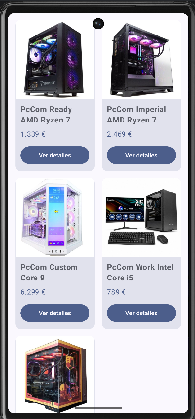
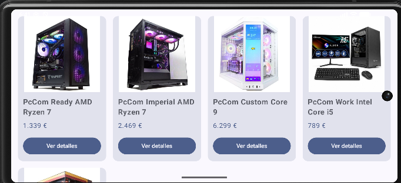
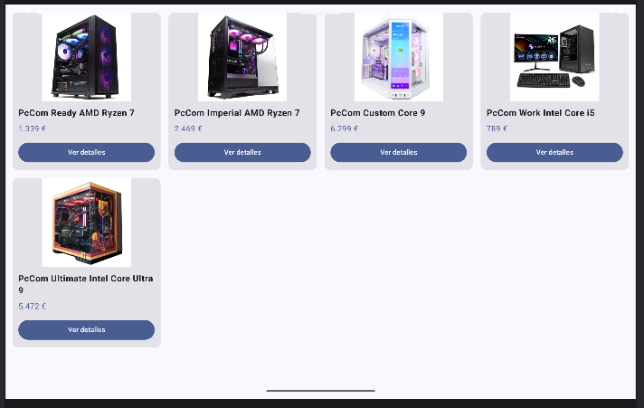

# Reto 2 · E-Commerce Adaptativo (Responsive UI)

**Módulo:** 0489 · Programación Multimedia y Dispositivos Móviles
**Autor:** [Tu Nombre y Apellidos]
**Tecnología:** Kotlin + Jetpack Compose (Android nativo)
**RA vinculado:** RA1 y RA2 · Interfaces adaptables y limitaciones del dispositivo

## 📱 Producto Final (Capturas)

### Esquema de referencia
Así debería comportarse tu cuadrícula: mismas tarjetas, mismo código, más columnas cuando hay más espacio.

## 🎯 Objetivo del reto
Comprender la fragmentación de pantallas en Android y resolver los problemas de visualización en distintos perfiles de dispositivos. Pasar de un diseño estático (una lista infinita que se deforma) a una interfaz *responsive* (una cuadrícula inteligente) utilizando componentes de Jetpack Compose que calculan el espacio disponible en tiempo real.

## 🛠️ Componentes y conceptos utilizados

| Componente / Concepto | Para qué se usa en esta app |
| :--- | :--- |
| **LazyVerticalGrid** | Sustituye a `LazyColumn` para crear una cuadrícula en lugar de una lista simple. |
| **GridCells.Adaptive** | Calcula automáticamente cuántas columnas caben en la pantalla indicando solo el tamaño mínimo por tarjeta. |
| **Card** | Crea un contenedor elevado y con bordes redondeados para agrupar la imagen y los datos de cada producto. |
| **ContentScale.Crop** | Asegura que la imagen llene el espacio asignado recortando los bordes en lugar de deformarse al rotar la pantalla. |
| **maxLines & TextOverflow** | Fuerza a que los textos largos ocupen una sola línea y añade puntos suspensivos (`...`) para no descuadrar las tarjetas. |
| **Mock Data (Datos)** | Uso de una `data class` y una lista local para simular la información antes de conectar una base de datos real. |

## 🧐 Reflexión y Pensamiento Crítico
*(Por que no salian bien las imagenes: Por que el LazyVerticalGrid estaba mal configurado).*
*(Por que al arrancar la app, no salian las columnas bien: Por que las secciones column no estaban organizadas de la manera correcta).*

1. **Sobre la adaptabilidad:** ¿Por qué hemos usado `GridCells.Adaptive(minSize = ...)` en lugar de fijar el número de columnas con `GridCells.Fixed(2)`? ¿Qué ventaja tiene en el mundo real?
   > *[Por que nos permite crear celdas de forma mas eficiente, en el mundo real si se piden muchas columnas, solo habria que cambiar una linea de codigo]*

2. **Sobre el diseño UI:** ¿Qué ocurría con las tarjetas si el nombre de un producto era muy largo y ocupaba dos líneas mientras los demás ocupaban una? ¿Cómo lo hemos solucionado?
   > *[Que se solaparian entre si y lo he solucionado haciendo el texto mas corto]*

3. **Sobre las imágenes:** ¿Por qué es importante usar `ContentScale.Crop` en la imagen del producto cuando cambiamos el ancho de la tarjeta al rotar la pantalla?
   > *[Por que sino al rotar la pantalla, la imagen no se ajustaria]*

4. **Visión de futuro:** Ahora mismo nuestros productos están escritos directamente en el código (*hardcodeados*). ¿Qué crees que necesitaría nuestra app en el futuro para que esta tienda mostrara productos reales de internet?
   > *[Necesitaria unos enlaces reales a productos que existan]*

## 🚀 Cómo ejecutar el proyecto
1. Clonar el repositorio y abrir en Android Studio.
2. Ejecutar (▶) primero en un emulador de móvil (ej. Pixel 6).
3. Girar la pantalla del móvil a horizontal o ejecutar en un emulador de Tablet para comprobar la adaptación de la cuadrícula.

## 🐞 Dificultades y cómo las resolví
*(Opcional: Si te atascaste en algo durante el reto, explica aquí qué fue y cómo lo solucionaste).*
- *[Explica aquí tu dificultad]*

*[Enlace Github: https://github.com/TitoKarl/pmdm_udit/tree/main/PC_Tienda]*
