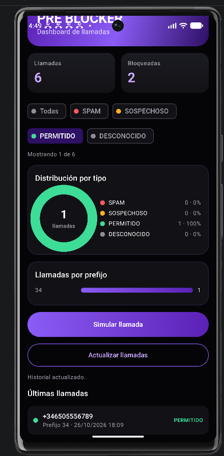
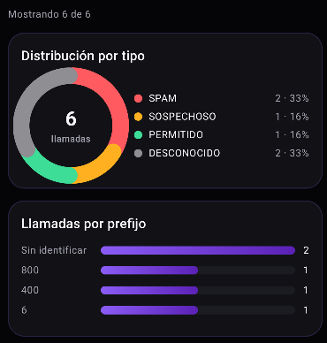
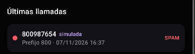
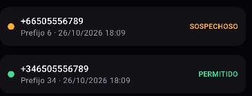

# Filtro de llamadas 400

Aplicación Android desarrollada en Kotlin que utiliza el servicio nativo
`CallScreeningService` para rechazar llamadas entrantes cuyo número coincide
con una regla de bloqueo. Incluye una regla inicial para el prefijo `400`,
gestión local de reglas y un historial de decisiones.

> **Estado de la demostración:** las pruebas unitarias de la lógica están
> implementadas. La demostración con llamadas reales debe realizarse en un
> dispositivo y documentarse con evidencias; una simulación dentro de la
> aplicación no demuestra que Android haya filtrado una llamada real.

## Enlaces de entrega

- **APK:** se genera localmente en `build/outputs/apk/debug/filtro400-debug.apk` al compilar el proyecto.

## Funcionalidades

- Solicita al usuario el rol de filtrado de llamadas de Android y permite
  activar o desactivar el bloqueo del prefijo `400`.
- Rechaza una llamada entrante cuando la regla activa que coincide determina
  que debe bloquearse. Las llamadas que no coinciden se permiten.
- Normaliza los números eliminando caracteres que no sean dígitos y contempla
  el prefijo español `+34` y el formato `0034`.
- Permite crear reglas de prefijo, bloqueo de número exacto y lista blanca.
  También permite editar, activar, desactivar y eliminar reglas.
- Da prioridad a la lista blanca. Para las demás reglas aplica primero la de
  mayor prioridad; en caso de empate, prevalece el bloqueo de número exacto
  frente a una regla de prefijo.
- Guarda reglas e historial localmente en SQLite. El historial distingue las
  simulaciones de las decisiones recibidas por el servicio.
- Ofrece una comprobación/simulación de números, estadísticas e importación y
  exportación de reglas CSV (`tipo,valor,activa,prioridad`).

## Requisitos

- Android Studio con soporte para Kotlin y Gradle.
- Android 10 (API 29) o posterior, correspondiente al `minSdk` del proyecto.
- Para filtrar llamadas reales, un dispositivo compatible y el rol
  `ROLE_CALL_SCREENING` concedido por el usuario. La disponibilidad del
  filtrado puede depender también de la versión de Android, el fabricante y
  el operador.

## Compilar, instalar y ejecutar pruebas

Desde la carpeta del proyecto:

```bash
./gradlew test assembleDebug
```

El APK de depuración se encontrará en:

```text
build/outputs/apk/debug/filtro400-debug.apk
```

Para instalarlo en un dispositivo conectado por ADB:

```bash
adb install -r build/outputs/apk/debug/filtro400-debug.apk
```

Abre **Filtro de llamadas**, concede el rol cuando Android lo solicite y activa
el filtro. El servicio no puede intervenir en llamadas reales hasta que el
usuario haya concedido ese rol.

## Funcionamiento y decisiones técnicas

1. `MainActivity` solicita el rol de filtrado mediante el sistema de roles de
   Android y guarda el estado de activación del filtro.
2. Android invoca `FiltroLlamadasService`, una implementación de
   `CallScreeningService`, cuando una llamada entrante se entrega al servicio.
3. El servicio obtiene el número disponible, consulta las reglas en SQLite y
   delega la decisión a `MotorFiltro`.
4. Si la regla indica bloqueo, el servicio responde a Android rechazando la
   llamada y omitiendo su notificación. Si no hay regla coincidente, responde
   permitiéndola.
5. Después de responder, intenta registrar la decisión en el historial. De
   este modo, la escritura del historial no retrasa la respuesta de filtrado.

La regla inicial bloquea el prefijo `400`. Por ejemplo, `400123456`,
`+34 400123456` y `0034 400123456` se normalizan y se comparan con esa regla.
El prefijo es configurable mediante las reglas de la aplicación.

El filtrado se realiza en el dispositivo: no se envía el número a un servidor
ni se necesita conexión a Internet para evaluar las reglas. Si el número no
está disponible, no se puede comparar y la llamada se permite. Si falla la
consulta de reglas SQLite, la implementación también permite la llamada y
registra el error en el log de Android, evitando bloquearla por un fallo
interno.

## Pruebas y evidencias


### Pruebas unitarias

Las pruebas de `MotorFiltroTest` cubren:

- Bloqueo de un número con prefijo `400` y normalización de `+34`.
- Lista blanca con prioridad sobre el prefijo, incluyendo `0034`.
- Aplicación de la regla de mayor prioridad.
- Desempate entre número exacto y prefijo.
- Ignorar reglas desactivadas.

Ejecutarlas con `./gradlew test`. Estas pruebas verifican la lógica de decisión;
no simulan el sistema de telefonía ni demuestran que una llamada real se haya
bloqueado.

### Evidencias que deben añadirse

No se incluyen capturas ni grabación de llamadas reales en este repositorio por
el momento. Para completar la entrega, añadir evidencias propias, por ejemplo:

| Evidencia | Qué debe mostrar |
|---|---|
|  | Aplicación abierta y estado del filtro. |
|   Solicitud o estado del rol de filtrado del sistema. |
|  | Resultado de una llamada real de prueba cuyo número presentado comienza por 400. |
|  | Resultado de una llamada real de prueba desde un número que no coincide. |
|  | Resultado de `./gradlew test`. |

Realizar las llamadas de prueba únicamente con líneas y dispositivos autorizados.
En la grabación de hasta tres minutos, mostrar tanto la llamada bloqueada como
otra llamada permitida. No presentar el comprobador o la simulación de la app
como si fueran llamadas reales.

## Reflexión crítica

### 1. ¿Qué es `CallScreeningService` y qué función cumple en Android?

Es una api que nos permite designa un rol a la app para que ciertas llamadas sean respondidas de la manera correcta

### 2. ¿Por qué necesitamos solicitar el rol `ROLE_CALL_SCREENING`?

Por que el rol se encarga de autorizar el filtrado y permite que se dirigan las llamadas permitidas

### 3. ¿Por qué no necesitamos un servidor externo para realizar el filtrado?


Por que se realiza localmente desde el dispositivo del usuario

### 4. ¿Qué ocurre si el número telefónico está guardado en los contactos?

Que puede ser excluido de las llamadas bloqueadas

### 5. ¿Qué diferencias existen entre comprobar un número mediante una función y bloquear realmente una llamada?

Que un número se ejecuta co funciones de texto y reglas, y solo informa qué
decisión tomaría el motor.  Android se tiene que encarfar de bloquear las llamadas con el "CallScreeningService.

### 6. ¿Qué mejoras incorporarías en una futura versión?

- Pondria una opcion de añadir prefijos filtrados
- Permitiria al usuario elegir si se guardan llamadas de un prefijo pretederminado
- Permitir al usuario elegir si se reciben las llamadas o se cuelgan automaticamente

## Estructura principal

